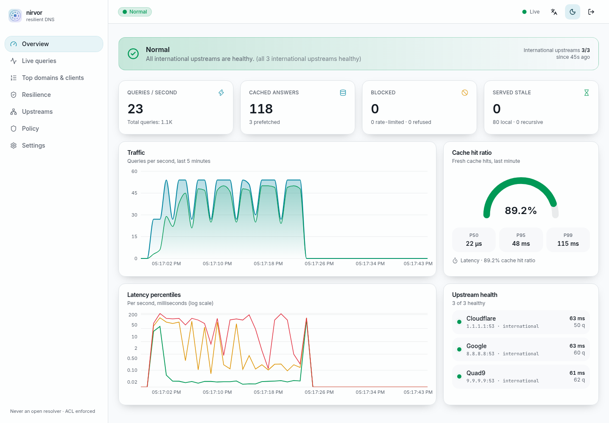
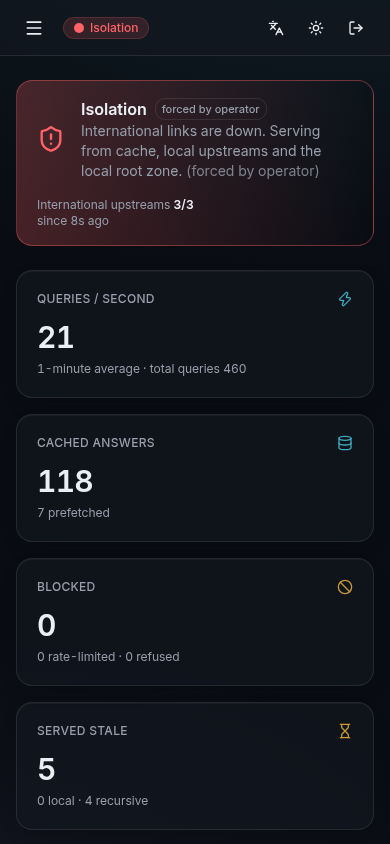
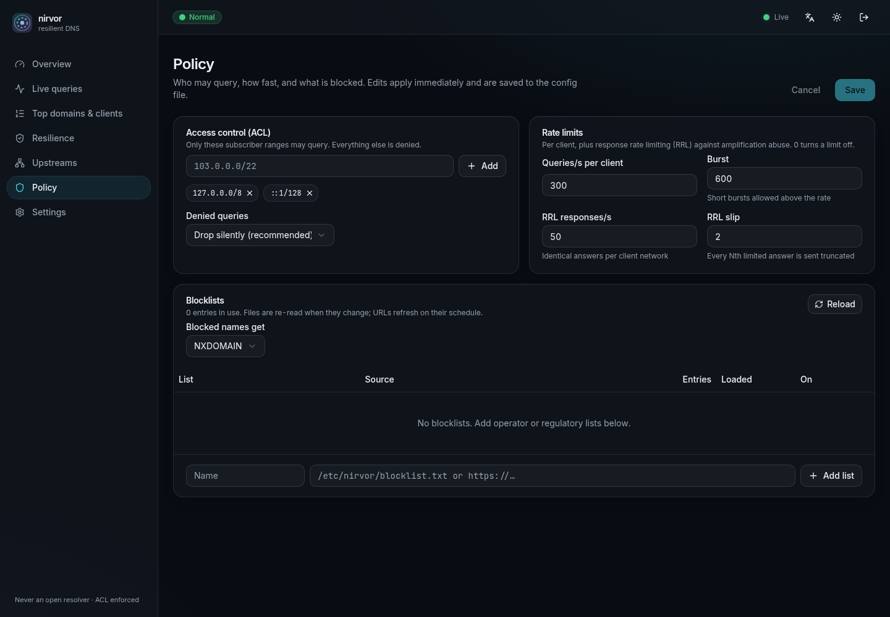
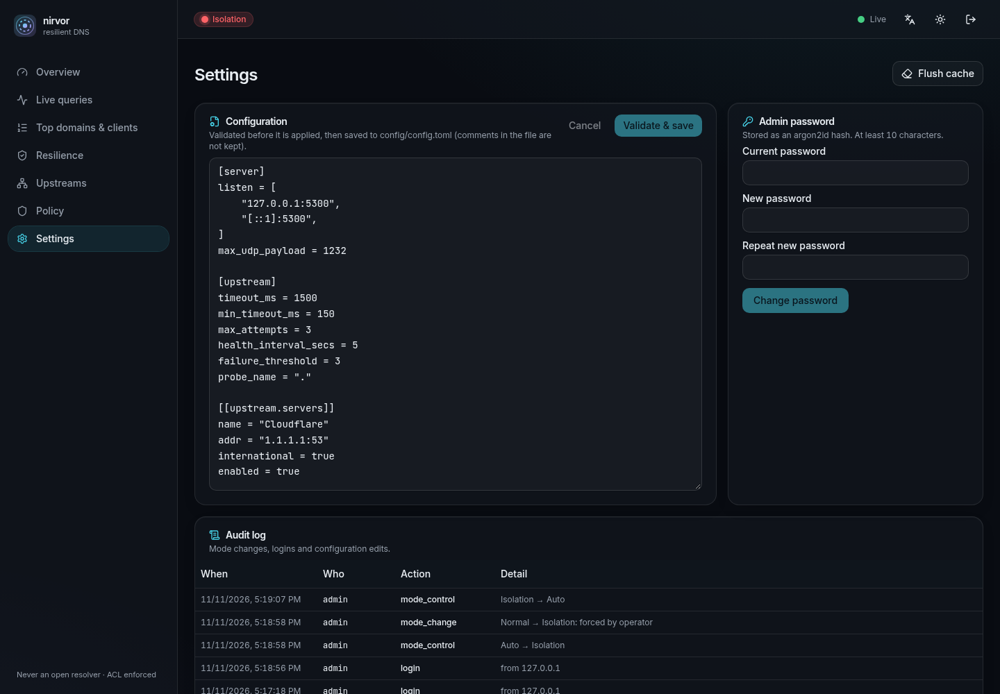

<div align="center">

# nirvor

**A resilient, caching DNS resolver for ISPs in Bangladesh, with a built-in live dashboard.**
*Nirvor* (নির্ভর) means "dependable".

[](https://github.com/Muktaditbf/nirvor/actions/workflows/ci.yml)
[](LICENSE)


</div>

## Why

When Bangladesh's international links fail, from a cable cut, an upstream fault or a shutdown, local networks often keep working. Local websites still stop opening, though, because DNS depends on servers abroad.

nirvor keeps local resolution working through outages like that:

- **Serve-stale cache (RFC 8767).** Names it has seen keep answering, for up to 7 days during an outage.
- **Verified local root zone (RFC 8806).** It is downloaded from IANA and checked with DNSSEC and ZONEMD (RFC 8976). With it, nirvor resolves names itself when every forwarder is unreachable, so names hosted inside the country still work.
- **Pinned domains.** The local sites your subscribers rely on are kept warm and served for up to 30 days.
- **Automatic isolation mode.** It switches to local-only upstreams and local answers for OS connectivity checks, so devices don't show "No Internet" while local services work.

On a normal day it is a fast, health-checked caching forwarder, with ACLs, rate limiting, blocklists and an operator dashboard. It runs as one binary with sensible defaults, and it refuses to run as an open resolver.

<table>
<tr>
<td></td>
<td></td>
</tr>
<tr>
<td align="center"><sub>Isolation mode: forced by the operator here, normally automatic</sub></td>
<td align="center"><sub>Root zone, cache snapshot and pinned domains</sub></td>
</tr>
<tr>
<td></td>
<td></td>
</tr>
<tr>
<td align="center"><sub>Live query log (anonymized by default)</sub></td>
<td align="center"><sub>Upstream health and adaptive timeouts</sub></td>
</tr>
</table>

### How a query flows

```text
ACL → rate limit → blocklist → local zones → (isolation overrides) → local root zone
    → cache → upstream pool (coalesced, health-checked) → iterative fallback → serve-stale → reply (+RRL)
```

## Quick start

```sh
# Build the dashboard, then the binary (the dashboard is embedded in it)
(cd web && npm ci && npm run build)
cargo build --release

./target/release/nirvor -c config/config.toml
dig @127.0.0.1 -p 5300 example.com
```

Open http://127.0.0.1:8053. On first start an admin password is written to `data/initial-admin-password`.
Sign in, change it under **Settings**, then delete the file.

Before using it in production:

1. Set `policy.allow` to your subscriber ranges.
2. Set `server.listen` to port 53.
3. Set `resilience.data_dir` to `/var/lib/nirvor`.

See [docs/operations.md](docs/operations.md) for systemd and Docker.

## What it does

| Area | Features |
|---|---|
| Protocol | UDP and TCP, EDNS0 (RFC 6891), truncation and TCP fallback (RFC 7766), FORMERR/NOTIMP for bad input, never panics on malformed packets (fuzzed) |
| Cache | TTL-aware with min/max clamps, negative caching (RFC 2308), prefetch of popular entries, request coalescing, SERVFAIL caching |
| Upstreams | Health checks, RTT-based adaptive timeouts (RFC 6298), fastest-healthy-first failover, international/local tagging |
| Resilience | Serve-stale with client-response and failure-recheck timers (RFC 8767), local root zone verified by DNSSEC and ZONEMD (RFC 8806/8976), iterative resolution from the local root, persistent cache snapshot, pinned domains, static local zones |
| Isolation | Automatic detection with hysteresis plus manual control; local-only upstreams, extended stale window, connectivity-check overrides and a built-in responder; audit log |
| Security | Deny-by-default ACL, per-client rate limiting, response rate limiting with slip, hot-reloaded blocklists (files or URLs), query size limits, timeouts, bounded queues |
| Dashboard | Live charts (SSE), live query log, top domains/clients, resilience and upstream management, policy editor, config editor with validation, audit log; argon2id login, CSRF protection, optional HTTPS; dark and light themes, responsive, i18n (English, Bangla started) |
| Ops | Prometheus `/metrics`, JSON logs, graceful shutdown, systemd unit with hardening, Docker image |

## More screenshots

| Light theme | Phone | Policy | Settings |
|---|---|---|---|
|  |  |  |  |

## Development

```sh
cargo fmt --all && cargo clippy --all-targets -- -D warnings && cargo test   # 86 tests
(cd web && npm run dev)                                                      # dashboard with hot reload, proxies /api to :8053
bench/run.sh                                                                 # nirvor vs Unbound, results in bench/results/
```

Optional live tests use a downloaded root zone: `NIRVOR_ROOT_ZONE=/path/root.zone cargo test -p nirvor-resilience`.

## Docs

- [Architecture](docs/architecture.md)
- [Configuration reference](docs/configuration.md)
- [Operations runbook](docs/operations.md)
- [HTTP API](docs/api.md)
- [Benchmarks](docs/benchmarks.md)

## Limits worth knowing

- **DNSSEC.** Answers are not DNSSEC-validated by nirvor. DO and CD bits and RRSIGs are passed through and cached separately, and the root zone copy itself is fully verified. Answers from iterative resolution are unvalidated.
- **Encrypted DNS.** No DoT or DoH serving yet.
- **Speed.** Throughput is about 70% of Unbound's on the same cores, measured on the warm-cache path (see [benchmarks](docs/benchmarks.md)).
- **Port 53 interception.** Iterative resolution needs direct port-53 access to authoritative servers. Networks that intercept port 53 (as on the development machine) break it, but forwarding still works.

## License

[Apache-2.0](LICENSE). Contributions are welcome; see [CONTRIBUTING.md](CONTRIBUTING.md). Report security issues privately ([SECURITY.md](SECURITY.md)).
