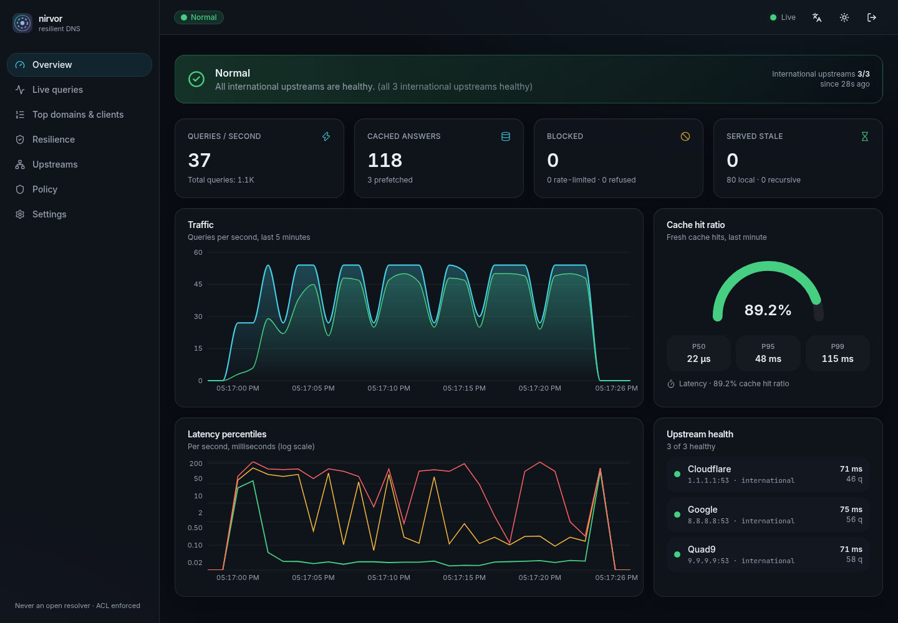
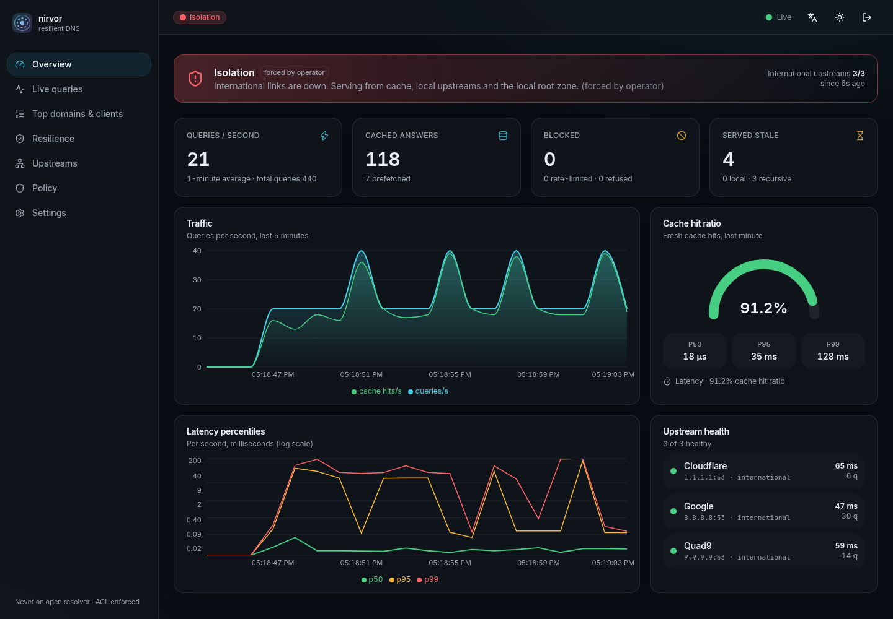
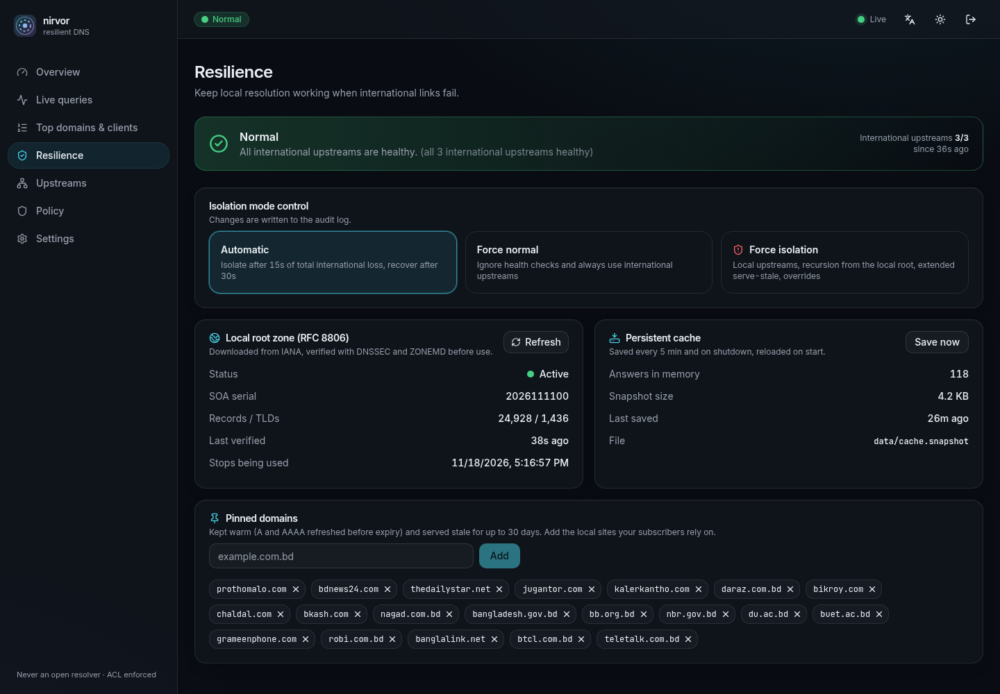
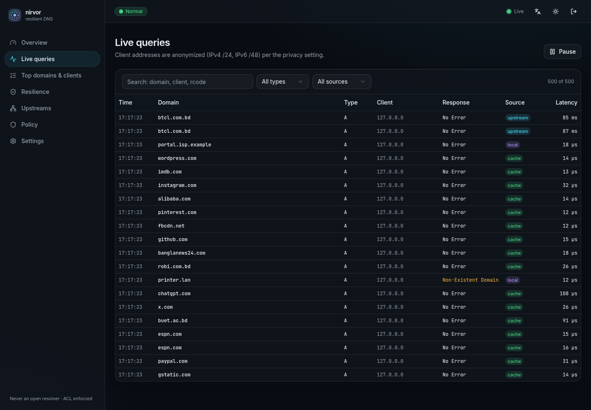
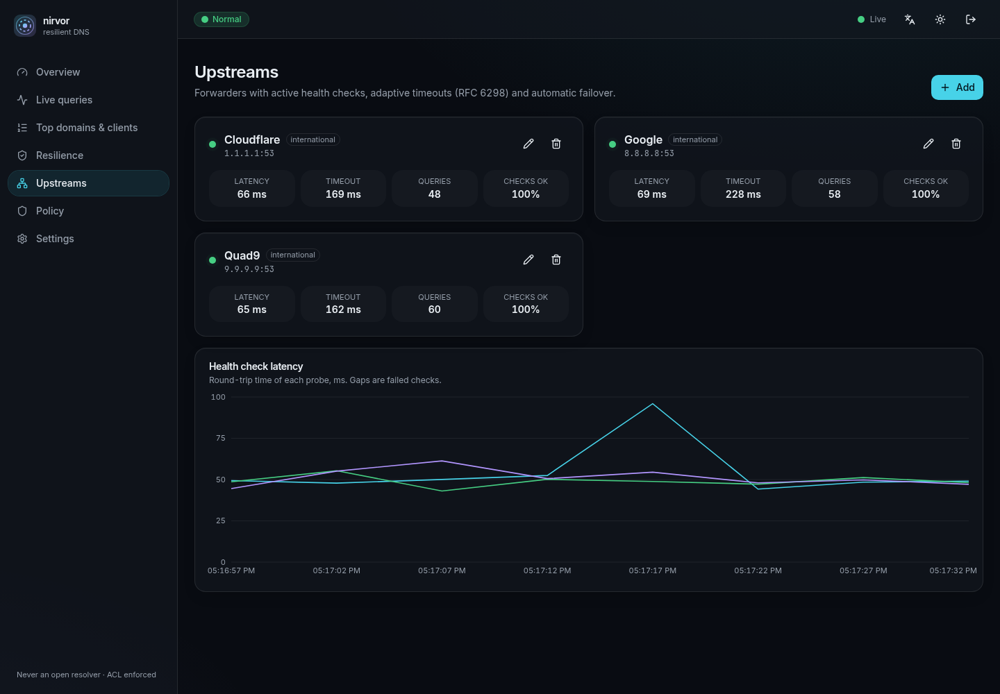
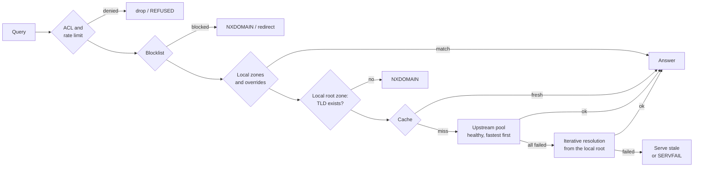
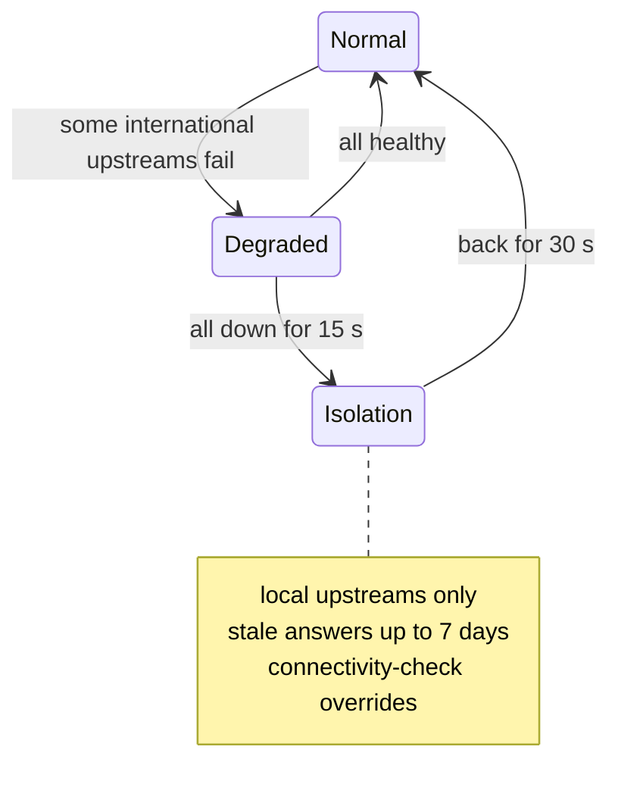

<div align="center">

# nirvor

**A resilient, caching DNS resolver for ISPs in Bangladesh, with a built-in live dashboard.**

*Nirvor* (নির্ভর) means "dependable". It keeps local websites resolving when international links go down.

[](https://github.com/Muktaditbf/nirvor/actions/workflows/ci.yml)
[](LICENSE)


[Quick start](#quick-start) · [Deploy](#deploying-for-an-isp) · [How it works](#how-it-works) · [Docs](#documentation) · [FAQ](#faq)



</div>

## The problem

Most small and mid-sized ISPs in Bangladesh forward their customers' DNS queries to public resolvers abroad. When international connectivity breaks, from a submarine cable fault, an upstream failure or a shutdown, those resolvers become unreachable. **Local** websites then stop opening too, even though they are hosted in the country and the local network still works. Banks, news, e-commerce and government services all disappear, only because the name lookup fails.

## What nirvor does about it

| When… | nirvor… |
|---|---|
| Everything is normal | Answers from a fast cache (~0.04 ms median), forwards misses to the fastest healthy upstream, and blocks abuse |
| An upstream gets slow or fails | Moves to the next upstream within its measured timeout (often ~150 ms instead of seconds) |
| All international upstreams are down for 15 s | Switches to **isolation mode** automatically and logs it |
| In isolation, a known name is asked | Answers from cache, even expired answers: up to 7 days, or 30 days for **pinned** local sites |
| In isolation, a new name is asked | Asks your local/BDIX resolvers, or resolves it **itself** from a verified local copy of the root zone, which works for names whose servers are inside the country |
| Phones check "am I online?" | Can answer those checks locally, so devices don't show "No Internet" while local services work |
| Links come back for 30 s | Returns to normal by itself and refreshes stale answers |

It is a single binary with sensible defaults and an operator dashboard, and it **refuses to run as an open resolver**.

<table>
<tr>
<td width="50%"></td>
<td width="50%"></td>
</tr>
<tr>
<td align="center"><sub><b>Isolation mode</b>: automatic, or forced for drills</sub></td>
<td align="center"><sub><b>Resilience</b>: root zone, cache snapshot, pinned domains</sub></td>
</tr>
<tr>
<td></td>
<td></td>
</tr>
<tr>
<td align="center"><sub><b>Live queries</b>: streamed, filterable, anonymized by default</sub></td>
<td align="center"><sub><b>Upstreams</b>: health checks and adaptive timeouts</sub></td>
</tr>
</table>

## Quick start

**Needs:** Linux, Rust 1.88+ and Node.js 24+. To try it you can use `dig` (from `bind` or `dnsutils`).

```sh
git clone https://github.com/Muktaditbf/nirvor.git && cd nirvor
(cd web && npm ci && npm run build)      # build the dashboard (it is embedded into the binary)
cargo build --release
./target/release/nirvor -c config/config.toml
```

The example config listens on port **5300** (not 53), so it never interferes with your computer's own DNS.

Try it from a second terminal:

```sh
dig @127.0.0.1 -p 5300 prothomalo.com    # first time: fetched upstream (~50 ms)
dig @127.0.0.1 -p 5300 prothomalo.com    # second time: from cache (0 ms)
dig @127.0.0.1 -p 5300 portal.isp.example   # answered by a local zone from the config
dig @127.0.0.1 -p 5300 printer.lan       # NXDOMAIN straight from the local root zone, no upstream needed
```

Then open the dashboard at **http://127.0.0.1:8053**:

1. Read the first password with `cat data/initial-admin-password`.
2. Sign in.
3. Change the password under **Settings**.
4. Delete the file.

> **Tip:** to see isolation mode, go to **Resilience → Force isolation**, query a few names, then switch back to **Automatic**. Every step appears in the audit log.

## Deploying for an ISP

1. **Allow your subscribers, nobody else.** Set `policy.allow` to your customer ranges. Queries from anywhere else are dropped.
2. **Listen on port 53.** Set `server.listen = ["0.0.0.0:53", "[::]:53"]`.
3. **Add a local upstream if you have one** (your own resolver or one over BDIX) with `international = false`. It keeps working in isolation.
4. **Pin the local sites your customers depend on** in `resilience.pinned_domains`, or from the dashboard.
5. **Keep the dashboard private.** Bind `api.listen` to a management address, optionally with HTTPS.

A minimal production config:

```toml
[server]
listen = ["0.0.0.0:53", "[::]:53"]

[[upstream.servers]]
name = "Cloudflare"
addr = "1.1.1.1:53"

[[upstream.servers]]
name = "BDIX resolver"
addr = "203.0.113.53:53"
international = false

[policy]
allow = ["103.0.0.0/22", "2401:db00::/32"]   # your subscriber ranges

[resilience]
data_dir = "/var/lib/nirvor"
pinned_domains = ["prothomalo.com", "bkash.com", "bangladesh.gov.bd"]

[api]
listen = "10.0.0.2:8053"                      # management network only
```

Then install it as a service:

- **systemd** (hardened unit, binds port 53 without root): [`deploy/nirvor.service`](deploy/nirvor.service)
- **Docker:** `docker compose -f deploy/docker-compose.yml up -d --build`

Step-by-step install, monitoring, alerts and an outage playbook are in the [operations runbook](docs/operations.md). Every setting is in the [configuration reference](docs/configuration.md).

## How it works





The design choices that matter most:

- **The root zone copy is verified, not trusted.** It is downloaded from IANA and accepted only if the DNSKEY set chains to IANA's trust anchors, ZONEMD and SOA are validly signed, and the SHA-384 digest over all ~25,000 records matches (RFC 8806, RFC 8976).
- **Upstream health is measured.** Timeouts follow the measured round-trip time (RFC 6298), so a dead upstream costs ~150 ms instead of a fixed 2 s.
- **Popular names never stampede.** Identical misses share one upstream query, and popular entries are refreshed before they expire.
- **Nothing on the network path can crash it.** Malformed packets get FORMERR or are dropped. The pipeline is property-tested with thousands of random and mutated packets.

The full design is in [docs/architecture.md](docs/architecture.md).

## Features

| Area | What you get |
|---|---|
| **DNS** | UDP and TCP, EDNS0 (RFC 6891), truncation and TCP fallback (RFC 7766), 1232-byte UDP default (DNS Flag Day 2020), SO_REUSEPORT multi-socket listeners |
| **Cache** | TTL clamps, negative caching (RFC 2308), prefetch, request coalescing, serve-stale with client-response and failure-recheck timers (RFC 8767), snapshot that survives restarts |
| **Resilience** | Verified local root zone, iterative fallback resolver, pinned domains, static local zones, automatic isolation mode with hysteresis, connectivity-check overrides and a built-in HTTP responder |
| **Security** | Deny-by-default ACL (rejects `/0`), per-client token buckets (IPv6 grouped by /64), response rate limiting with slip, blocklists from files or URLs with hot reload, size limits, timeouts, bounded queues |
| **Dashboard** | Live charts over SSE, query log, top domains and clients with sparklines, upstream/policy/pinned-domain editors, config editor with validation, audit log, dark and light themes, mobile layout, English and Bangla (in progress) |
| **Operations** | Prometheus `/metrics`, JSON logs, graceful shutdown, config check (`--check-config`), hardened systemd unit, distroless Docker image, REST API ([docs/api.md](docs/api.md)) |
| **Security of the dashboard** | argon2id password, HttpOnly SameSite=Strict session cookies, CSRF tokens, login throttling, CSP and security headers, optional HTTPS |

## Performance

Warm cache, the same machine, both servers pinned to 4 CPU cores, median of 3 runs ([full method and raw results](docs/benchmarks.md)):

| | Queries / second | p50 | p99 | Lost |
|---|---:|---:|---:|---:|
| **nirvor** 0.1.0 | 103,912 | 0.044 ms | 2.0–3.2 ms | 0 |
| Unbound 1.26.2 | 148,725 | 0.027 ms | 2.0–4.7 ms | 0 |

nirvor reaches about 70% of Unbound's throughput. That is far more than a small ISP needs: typical peaks are 2–20k qps. Reproduce with `bench/run.sh`.

## Project layout

```text
crates/
  core/        listeners, query pipeline, metrics, isolation mode, query log
  cache/       TTL cache, negative caching, serve-stale, snapshots
  upstream/    upstream pool, health checks, adaptive timeouts
  resilience/  root zone download and verification, iterative resolver
  zones/       static local zones
  policy/      ACL, rate limiting, RRL, blocklists
  storage/     SQLite: audit log, settings, traffic history
  api/         REST API, SSE stream, auth, embedded dashboard
  server/      the `nirvor` binary
  bench/       dnsperf-style load generator
web/           React + TypeScript dashboard (Vite, Tailwind CSS, shadcn/ui, Recharts)
deploy/        Dockerfile, docker-compose, systemd unit
docs/          architecture, configuration, operations, API, benchmarks
```

## Development

```sh
cargo fmt --all && cargo clippy --all-targets -- -D warnings && cargo test --all
(cd web && npm run dev)   # dashboard with hot reload; proxies /api to 127.0.0.1:8053
bench/run.sh              # nirvor vs Unbound
```

CI runs formatting, clippy, all tests, the dashboard build and the Docker build on every push. See [CONTRIBUTING.md](CONTRIBUTING.md).

## Documentation

| Document | For |
|---|---|
| [Architecture](docs/architecture.md) | How the pipeline, cache, upstream pool, root zone and isolation mode work |
| [Configuration](docs/configuration.md) | Every setting, its default, and whether it applies live |
| [Operations](docs/operations.md) | Installing, monitoring, alerts, outage playbook, troubleshooting |
| [HTTP API](docs/api.md) | Automating nirvor or building on it |
| [Benchmarks](docs/benchmarks.md) | Method, environment and raw results |

## Roadmap

- [ ] DNSSEC validation of answers (today: passed through, cached separately per DO/CD)
- [ ] DNS over TLS and DNS over HTTPS for clients
- [ ] Complete Bangla translation of the dashboard
- [ ] Faster cache hits (patch stored wire bytes instead of re-encoding)
- [ ] Pre-built release binaries and container images

## FAQ

**Is this a censorship circumvention tool?**
No. It respects operator-configured blocklists, such as regulatory ones, and only serves the subscriber ranges you allow.

**Why not just run Unbound or Knot?**
They are excellent and faster. nirvor is built around one scenario: staying useful during international isolation (verified local root, pinned domains, automatic isolation, connectivity-check overrides), with defaults and a dashboard a small ISP can run without a DNS specialist.

**Does it validate DNSSEC?**
Not yet. It verifies the root zone copy cryptographically, but it passes answer DNSSEC data through without validating it. See the roadmap.

**Will iterative resolution work on my network?**
Only if outbound port 53 reaches authoritative servers directly. Some networks intercept port 53. Forwarding still works there.

## Contributing and security

Contributions are welcome, especially from people running networks in Bangladesh. [CONTRIBUTING.md](CONTRIBUTING.md) explains the setup and lists good first contributions. Report security problems privately through [SECURITY.md](SECURITY.md).

## License

[Apache License 2.0](LICENSE).

Built on [Hickory DNS](https://github.com/hickory-dns/hickory-dns), [Tokio](https://tokio.rs), [axum](https://github.com/tokio-rs/axum), [moka](https://github.com/moka-rs/moka) and [sqlx](https://github.com/launchbadge/sqlx). The root zone and trust anchors come from [IANA](https://www.iana.org/domains/root/files).
